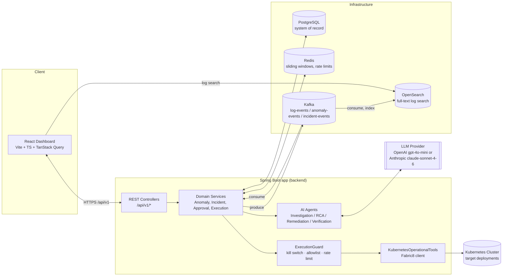
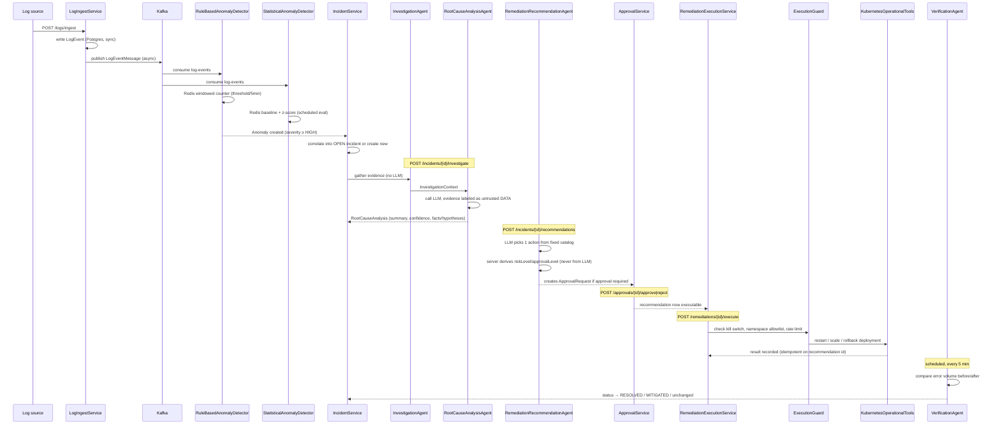
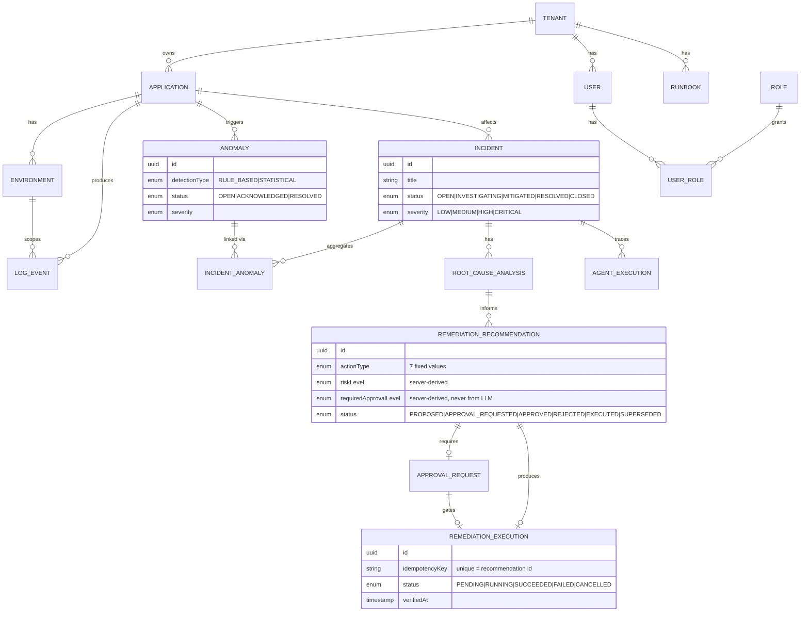

# Architecture

This document describes how the AI Enterprise Operations Agent (AIOps) platform is put
together: the system components, the data model, the agent pipeline, and the safety layer
around autonomous remediation. For setup/run instructions and a hands-on walkthrough, see
[README.md](README.md).

## 1. System overview

The platform is a closed-loop AIOps pipeline:

```
logs → anomaly → incident → RCA (LLM) → remediation recommendation (LLM)
     → human approval → Kubernetes execution → verification
```

Every stage is a real REST call, persisted in Postgres, and reflected live on the React
dashboard. LLMs propose (root cause hypotheses, a remediation action); they never execute
anything directly, and risk/approval decisions are always derived server-side rather than
trusted from model output.



## 2. Request/data flow — the end-to-end pipeline



## 3. Backend package map

`backend/src/main/java/com/ai/aiops/`

| Package | Responsibility |
|---|---|
| `api/` | REST controllers + request/response DTOs — the only HTTP-facing layer |
| `logs/` | Ingestion: `LogIngestService`, `LogFileIngestService`, `LogNormalizer`, `LogSearchService` |
| `kafka/` | Topic constants, producers (`LogEventProducer`, `DomainEventProducer`), message records |
| `opensearch/` | `OpenSearchIndexingService` (Kafka consumer → monthly index), template setup |
| `anomaly/` | `RuleBasedAnomalyDetector`, `StatisticalAnomalyDetector`, `AnomalyService`, `IncidentService`, `AnomalyWindowCounterService` (Redis) |
| `agent/` | `InvestigationAgent` (no LLM), `RootCauseAnalysisAgent` (LLM), `RootCauseAnalysisService` (orchestration + audit) |
| `remediation/` | `RemediationRecommendationAgent` (LLM), `RemediationRecommendationService`, `RemediationActionType` (fixed catalog enum) |
| `approval/` | `ApprovalService` (pending/approved/rejected/expired lifecycle), `UserResolver` |
| `execution/` | `RemediationExecutionService`, `ExecutionGuard` (kill switch/allowlist/rate limit), `KubernetesOperationalTools` (Fabric8), `VerificationAgent` |
| `dashboard/` | Read-side query services: `DashboardService`, `IncidentQueryService`, `AnomalyQueryService`, `AuditQueryService` |
| `domain/` | JPA entities (see §4) |
| `repository/` | Spring Data JPA repositories, one per aggregate root |
| `config/` | `LlmConfig` (OpenAI/Anthropic provider selection), Kafka/Redis/Kubernetes/OpenAPI/Security config |
| `common/` | `BaseEntity`/`BaseCreatedEntity`, `GlobalExceptionHandler`, `CorrelationIdFilter`, custom exceptions |
| `security/` | Placeholder — see [What's implemented vs. deferred](README.md#whats-implemented-vs-deferred) |

**Layering rule:** `api` → `*Service` → `*Agent`/`repository` → `domain`. Controllers never
touch repositories directly; agents never call controllers; only `ExecutionGuard` and
`KubernetesOperationalTools` are allowed to reach the Kubernetes API.

## 4. Data model



Schema source of truth: Flyway migrations `backend/src/main/resources/db/migration/V1`–`V7`.
All tables use UUID primary keys and `created_at`/`updated_at` audit columns.

## 5. AI agents

| Agent | Calls LLM? | Input | Output | Key safety property |
|---|---|---|---|---|
| `InvestigationAgent` | No | Linked anomalies, recent ERROR/FATAL logs, trace IDs, past incidents, matching runbooks | `InvestigationContext` | Pure evidence gathering — nothing is sent to a model yet |
| `RootCauseAnalysisAgent` | Yes | `InvestigationContext` (JSON) | `RcaOutput`: summary, confidence, confirmed facts, hypotheses, evidence gaps | System prompt labels all log/exception content as untrusted **DATA**, never instructions (prompt-injection guardrail, asserted by a test that captures the real prompt) |
| `RemediationRecommendationAgent` | Yes | Latest RCA output + incident context | `RemediationOutput`: one `RemediationActionType` + description/outcome/rollback | Can only select from a **fixed 7-action enum** — cannot invent a command. `riskLevel`/`requiredApprovalLevel` are then overwritten server-side from the enum, regardless of what the LLM says |
| `VerificationAgent` | No | Error-log volume in 5-min windows before/after execution | `RESOLVED` / `PARTIALLY_RESOLVED` / `UNRESOLVED` | Never declares success without comparing an actual "after" window |

**Provider selection** (`config/LlmConfig.java`, driven by `aiops.llm.provider` / `AIOPS_LLM_PROVIDER`):
- `openai` (default) → `gpt-4o-mini` via Spring AI's `OpenAiChatModel`
- `anthropic` → `claude-sonnet-4-6` via Spring AI's `AnthropicChatModel`

The app starts with no key configured; agents only fail (`LlmUnavailableException` → HTTP 503)
when actually invoked, not at boot.

Every agent run — success or failure — is recorded as an `AgentExecution` row (type, input,
output, timing), independent of whatever it produced, so the Audit Center page has a complete
trace regardless of outcome.

## 6. Anomaly detection

Two independent Kafka consumers on `log-events`, both backed by Redis:

- **`RuleBasedAnomalyDetector`** — windowed count of `(application, exceptionType)` over
  `aiops.anomaly.rule.window-minutes` (default 5 min). Fires once at `aiops.anomaly.rule.threshold`
  (default 10), severity `MEDIUM`/`HIGH`/`CRITICAL` at 1×/2×/3× threshold, with escalation-in-place
  if the count keeps climbing in the same window (no duplicate anomalies).
- **`StatisticalAnomalyDetector`** — rolling baseline of error rate per application (Redis list,
  `aiops.anomaly.statistical.baseline-sample-size` samples), evaluated on a schedule; fires when
  `|z-score| ≥ aiops.anomaly.statistical.zscore-threshold` (default 2.5) and volume is non-trivial
  (≥5 events in-window).

**`IncidentService`** only opens or extends an `Incident` for `HIGH`/`CRITICAL` anomalies — a
lone `MEDIUM` burst (the common case under light test traffic) stays an anomaly and never becomes
an incident, which is intentional (see README's "Note on severity").

## 7. Remediation execution safety layer

```
RemediationExecutionService
    → ExecutionGuard   (kill switch → namespace allowlist → resource-name regex → per-target rate limit)
    → KubernetesOperationalTools (Fabric8 client; restart / scale / rollback)
```

- **Kill switch** — `AtomicBoolean`, flippable at runtime via `POST /admin/execution/{disable,enable}`,
  no redeploy needed.
- **Namespace allowlist** — `aiops.execution.allowed-namespaces` (default `default` only).
- **Resource-name validation** — Kubernetes DNS-1123 regex, rejects anything that isn't a valid
  deployment name.
- **Rate limit** — `aiops.execution.max-per-hour` (default 5) per `(namespace, resourceName)`,
  tracked in Redis with an hourly bucket key.
- **Idempotency** — `RemediationExecution.idempotencyKey` = recommendation ID, so calling
  `/execute` twice replays the recorded result instead of re-running the mutation.
- **Approval gate** — only `NONE`-approval actions (the 4 read-only/diagnostic ones) can run
  without a prior `APPROVED` `ApprovalRequest`; the 3 mutating actions
  (`RESTART_DEPLOYMENT`, `SCALE_DEPLOYMENT`, `ROLLBACK_DEPLOYMENT`) always require one.

## 8. Messaging & search

| Topic | Producer | Consumer(s) | Purpose |
|---|---|---|---|
| `log-events` | `LogIngestService` | `RuleBasedAnomalyDetector`, `StatisticalAnomalyDetector`, `OpenSearchIndexingService` | Fan out ingested logs to detectors + search indexer |
| `log-events.dlt` | (Kafka error handler) | — | Dead-letter sink for failed consumption |
| `anomaly-events` | `DomainEventProducer` | — (available for future consumers) | Anomaly lifecycle notifications |
| `incident-events` | `DomainEventProducer` | — (available for future consumers) | Incident opened / anomaly-linked notifications |

Postgres is the system of record (synchronous write on ingest); Kafka → OpenSearch indexing is
asynchronous, so a slow or down search cluster never blocks log ingestion. Logs are indexed into
monthly OpenSearch indices (`log-events-yyyy.MM`) for cheap retention management.

## 9. Scheduled jobs

| Job | Interval (config key) | Purpose |
|---|---|---|
| `StatisticalAnomalyDetector.evaluateCompletedWindow()` | `aiops.anomaly.statistical.window-minutes` (default 5 min) | Evaluate the just-closed statistical window and fire anomalies |
| `ApprovalService` expiry sweep | `aiops.approval.expiry-check-minutes` (default 60 min) | Move stale `PENDING` approvals past `aiops.approval.ttl-hours` to `EXPIRED` |
| `RemediationExecutionService.verifyCompletedExecutions()` | `aiops.verification.check-interval-minutes` (default 5 min) | Run `VerificationAgent` on executions completed ≥5 min ago; update incident status |

## 10. Frontend

`frontend/src/` — Vite + React 19 + TypeScript + Tailwind v4, routed with React Router, data
fetched with TanStack Query against an Axios client (`api/client.ts`, `baseURL: /api/v1`).

| Route | Page | Backend calls |
|---|---|---|
| `/` | Overview | `dashboard.overview()`, `dashboard.metrics()` |
| `/monitoring` | Live Monitoring | `logs.search()`, `anomalies.list()` |
| `/incidents` | Incidents list | `incidents.list()` |
| `/incidents/:id` | Incident detail — investigate / recommend / approve / execute / verify, all in one view | `incidents.get/investigate/analysis/recommend/recommendations/agentExecutions`, `approvals.approve/reject`, `remediations.execute/status` |
| `/remediation` | Remediation Center | `approvals.list('PENDING')`, `approvals.approve/reject`, recent executions |
| `/audit` | Audit Center | `audit.operational()`, `audit.agentExecutions()` |

`nginx.conf` (in the `frontend` Docker image) proxies `/api/*` to the backend and falls back to
`index.html` for client-side routes so deep links survive a hard refresh.

## 11. Deployment

- **Local / docker-compose** (`docker-compose.yml`): `postgres`, `redis`, `kafka` (KRaft, no
  Zookeeper), `opensearch` + `opensearch-dashboards`, `app`, `frontend` — see the port-mapping
  table in [README.md](README.md#running-everything-via-docker-compose).
- **Kubernetes** (`k8s/`, plain YAML, no Helm chart yet): namespace → Postgres/Redis/Kafka/
  OpenSearch → app `ConfigMap`/`Secret` → RBAC (`ServiceAccount` + `ClusterRole` scoped to exactly
  what `KubernetesOperationalTools` needs) → app `Deployment`/`Service` with liveness/readiness
  probes on `/actuator/health`. See `k8s/README.md` for apply order.
- **CI** (`.github/workflows/ci.yml`): backend tests (incl. Testcontainers), backend package
  build, frontend type-check + build, Docker image build sanity check.

## 13. Data architecture — analytics, governance & security

A second pipeline runs alongside the operational one in §2: a medallion-style ETL/ELT job that
turns the OLTP tables into a queryable analytics warehouse, with a real (if right-sized) data lake,
a governance catalog, and automated data quality checks. Package: `com.ai.aiops.warehouse`.

```
OLTP (Postgres public schema)          <- system of record, unchanged
        |  extract (WarehouseEtlJob, watermark-based)
        v
Bronze (S3-compatible object storage) <- raw, immutable, full-fidelity NDJSON.gz
        |  transform + aggregate (WarehouseLoader, SQL push-down)
        v
Warehouse (Postgres "analytics" schema) <- star schema: fact/dim tables, PII-safe by construction
        |
        v
REST API (/api/v1/warehouse/*) -> "Data Platform" dashboard page
```

**Why this shape:**
- **Warehouse = a dedicated `analytics` Postgres schema**, not a separate cloud warehouse engine.
  The ETL shape (extract -> stage raw in object storage -> transform/aggregate -> load fact/dim
  tables) is identical to what you'd run against Snowflake/BigQuery/Redshift — only the load target
  differs, which is the point: this is a portable pattern, not a Postgres-specific one.
- **Bronze format = gzip-compressed NDJSON**, not Parquet/Iceberg/Delta — avoids a heavy/fragile
  Hadoop filesystem shim in Java for what's otherwise a local/demo-scale stack. Converting bronze to
  a real columnar table format is the natural next step (see Deferred, below), called out rather
  than silently skipped — consistent with how the README handles the rest of this project's scope.
- **PII-safe by construction** — the warehouse's three fact tables
  (`analytics.fact_incident_daily`, `fact_remediation_daily`, `fact_log_volume_hourly`) carry only
  ids, enums, counts, and averages. No free-text log/exception/incident content ever reaches them;
  that content only exists in the OLTP system of record and the access-scoped bronze lake. This is
  asserted automatically, not just claimed: `DataQualityService`'s `pii_safety_no_free_text_columns`
  check reflects over the fact entities every ETL run and fails if a free-text/unbounded-string
  column is ever added to one.
- **Retention via an S3 bucket lifecycle rule** on the bronze bucket (`DataLakeWriter`, set once at
  startup), not a custom delete loop — the native way object stores expire old data.
- **Local/CI object storage runs on LocalStack** (`docker-compose.yml`'s `lake` service,
  `k8s/14-lake.yaml`), not MinIO — MinIO's own image stopped being pullable anonymously from Docker
  Hub/Quay/GHCR partway through this build (a licensing change by MinIO Inc), so LocalStack's S3
  emulation stands in instead. Nothing in `DataLakeConfig`/`DataLakeWriter` is LocalStack-specific
  — both talk to the generic AWS S3 SDK, so swapping the endpoint to real AWS S3, GCS's S3 interop,
  or a self-hosted MinIO (with your own Docker Hub login) needs zero Java changes, only an
  `AIOPS_LAKE_ENDPOINT` change.

**ETL/ELT job** (`WarehouseEtlJob`, `@Scheduled`, default hourly — `aiops.warehouse.etl.interval-minutes`):
watermarked by the last successful run's `EtlRunLog.watermarkTo` (first run looks back
`aiops.warehouse.etl.lookback-days-on-first-run`, default 7 days). Each run: (1) extracts
`log_events`/`incidents`/`remediation_executions` rows created since the watermark and writes them
raw to the bronze bucket (`DataLakeWriter`); (2) refreshes `analytics.dim_application`/`dim_date`
and upserts all three fact tables via native SQL push-down aggregation on the fact repositories
(`WarehouseLoader`) — idempotent by construction (`ON CONFLICT ... DO UPDATE`); (3) runs
`DataQualityService`'s four checks; (4) records one `EtlRunLog` row. Also triggerable on demand via
`POST /api/v1/warehouse/etl/run`.

**Data quality checks** (one `DataQualityCheck` row per check per run):
*completeness* (extraction finding rows implies the load step produced rows), *freshness* (the
last successful run isn't stale relative to the configured interval), *referential integrity*
(every fact row's `application_id`/`date_id` resolves to a dimension row), *PII-safety* (described
above).

**Governance catalog** (`data_catalog_entries`, seeded by `V10__seed_data_catalog.sql` for every
dataset the platform has — OLTP tables, the OpenSearch index, the bronze lake, and the warehouse
fact tables): dataset name, layer, physical location, owner, classification
(`PUBLIC`/`INTERNAL`/`CONFIDENTIAL`), a `containsPii` flag, and a retention period. Browsable via
`GET /api/v1/warehouse/catalog` and the Data Platform page's catalog table.

**Known simplification:** `fact_incident_daily.avg_mttr_seconds` is overwritten by each ETL run's
own window average rather than folded into a true cumulative running average across every run that
touches the same calendar day (see the comment on `FactIncidentDailyRepository.upsertResolvedCounts`)
— acceptable at this ETL cadence, called out rather than silently glossed over.

**Deferred (explicitly out of scope for this pass, same spirit as README's "What's implemented vs.
deferred"):**
- Bronze stays NDJSON.gz — no Parquet/Iceberg/Delta table format, no schema evolution tracking.
- No query engine over the lake itself (e.g. Trino/DuckDB/Athena) — the lake is written and
  retained, but only the warehouse (not the bronze objects) is queried day to day.
- No standalone catalog tool (DataHub/Amundsen) — `data_catalog_entries` is the metadata model
  without the UI/lineage-graph tooling built on top of it.
- No field-level encryption at rest, and no tenant-scoped access control on the warehouse/catalog
  API — inherits the same gap as the rest of the platform (`SecurityConfig` is an open placeholder,
  see §14).

## 15. MCP server — exposing the platform to AI clients

`mcp-server/` is a standalone Node/TypeScript service (not embedded in the Spring Boot app) that
exposes the backend's REST API as [MCP](https://modelcontextprotocol.io) tools, so any MCP client
(Claude Desktop, Claude Code, etc.) can query or drive this platform directly instead of going
through the React dashboard or raw curl. It's a thin, stateless HTTP proxy — a fresh `McpServer` +
transport per request (`@modelcontextprotocol/server` + `@modelcontextprotocol/express` +
`@modelcontextprotocol/node`), no database, no session state, zero backend code changes.

**Why standalone, not Spring AI's own MCP server support**: Spring AI's MCP starter needs a version
bump from the pinned `1.0.0-M5` to a GA release, risking `LlmConfig`'s careful workaround for
tolerating a missing LLM key at startup (built around that exact milestone's autoconfiguration
behavior). The standalone server sidesteps that entirely.

**29 tools, one per REST endpoint** except `POST /logs/upload` (multipart file upload — deliberately
not wrapped; disproportionate complexity for a case `ingest_log` already covers one event at a
time). Full list and how to connect a client: [`mcp-server/README.md`](../mcp-server/README.md).
Every tool carries MCP `annotations` (`readOnlyHint`/`destructiveHint`/`idempotentHint`) so a client
can decide how much confirmation UX to show — `execute_remediation`, `disable_execution`, and
`approve_remediation` are marked `destructiveHint: true` since they act on a real cluster or gate
human-in-the-loop approval.

**Two pagination shapes, confirmed by hitting the live endpoints (not assumed from a version
number)**: most list endpoints return Spring Data's `Page<T>`, which this app's pinned Boot/
spring-data-commons version serializes as the classic full shape (`content` + `pageable` + `total
Elements`/`totalPages` + `first`/`last`/`empty`/`numberOfElements` + top-level `size`/`number`/
`sort`) — *not* the newer compact `{content, page: {...}}` shape some spring-data-commons versions
use, which an earlier pass of this analysis assumed before it was checked against a real response.
`LogController.search` alone returns a different, hand-written `PagedResponse<T>` =
`{content, page: <number>, size, totalElements}`, where `page` is the page index, not a nested
object. Both are forwarded to the MCP client unchanged (`src/types.ts` documents the shapes; nothing
transforms them).

**The one new safety control this feature adds**: an optional shared-secret bearer check
(`MCP_API_KEY`) on the MCP server's own `/mcp` endpoint — off by default (matching this project's
pattern of tolerating a missing secret rather than crashing, same spirit as `LlmConfig`), but worth
setting before exposing this beyond a trusted local network, since several tools execute real
cluster mutations and the backend itself (`SecurityConfig`) has no auth of its own yet. This is a
plain static-secret check, not OAuth — the SDK's own `requireBearerAuth`/`OAuthTokenVerifier` expect
real token introspection (clientId, scopes, expiry), which doesn't fit a single shared secret.

**Deferred**: no per-tool-level auth/RBAC (the shared key is all-or-nothing — fine for one trusted
operator, not for multi-tenant MCP access, which needs the same OAuth2/RBAC work already deferred
everywhere else in this project, see §16).

## 16. Known gaps (by design, not oversight)

See the README's [What's implemented vs. deferred](README.md#whats-implemented-vs-deferred) for
the full list — most notably: `SecurityConfig` is an intentionally open placeholder (no
OAuth2/JWT/RBAC yet), so every endpoint is unauthenticated. Don't expose this beyond local
development as-is.
